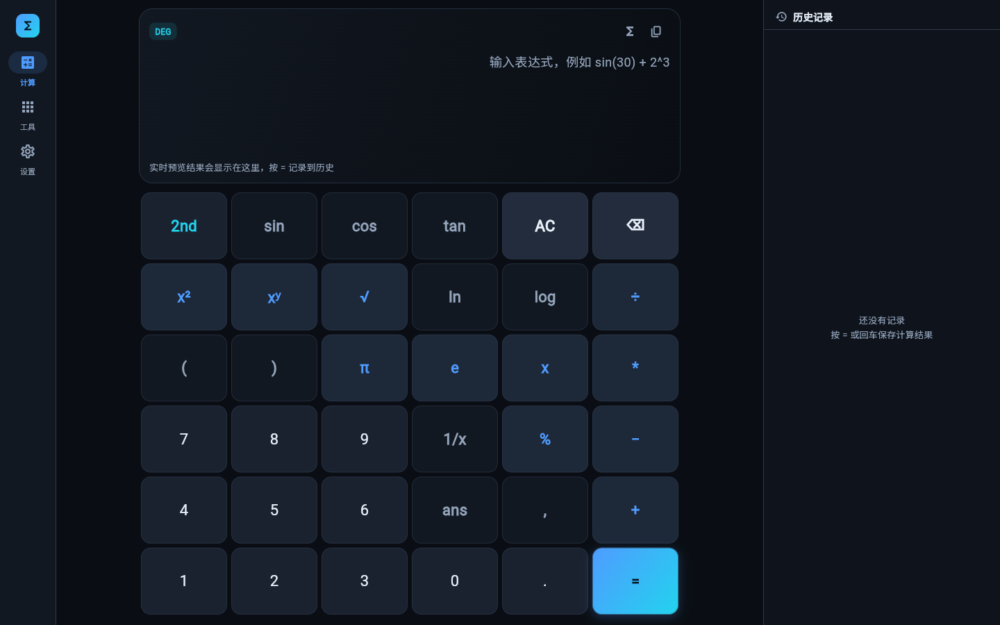
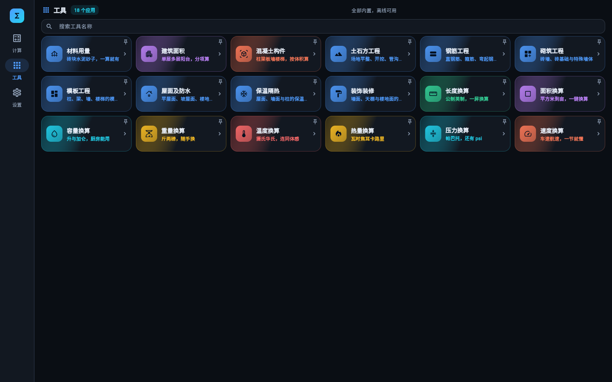
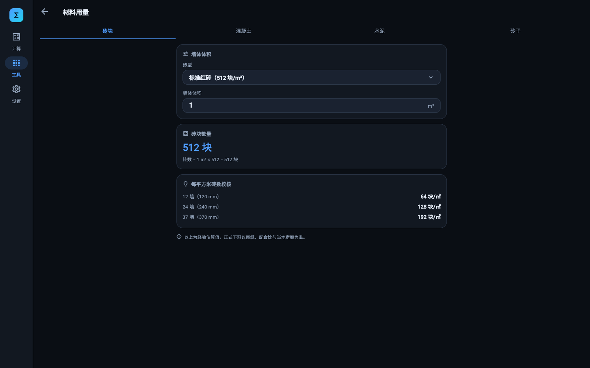
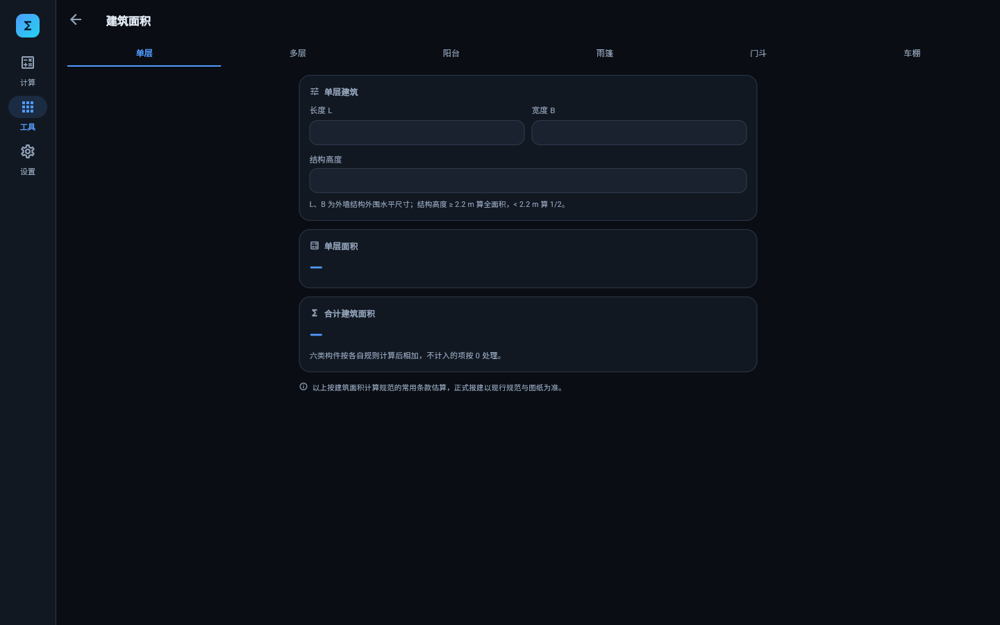
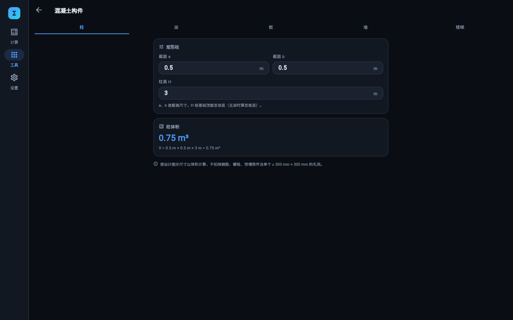
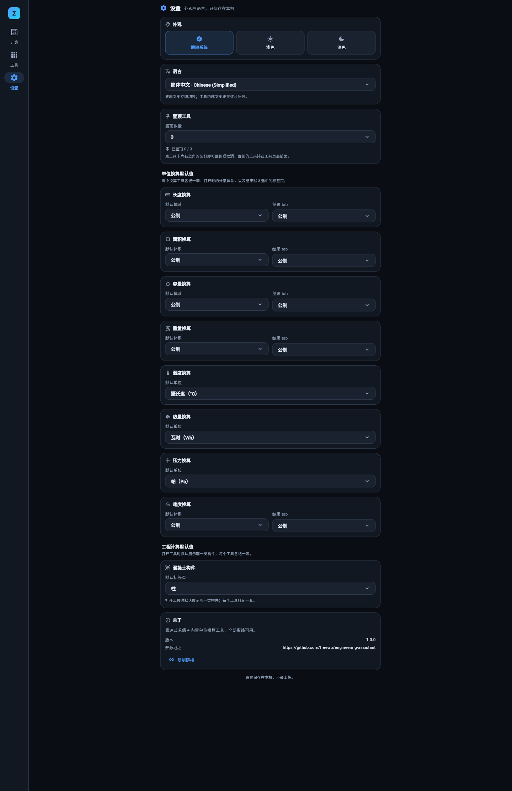
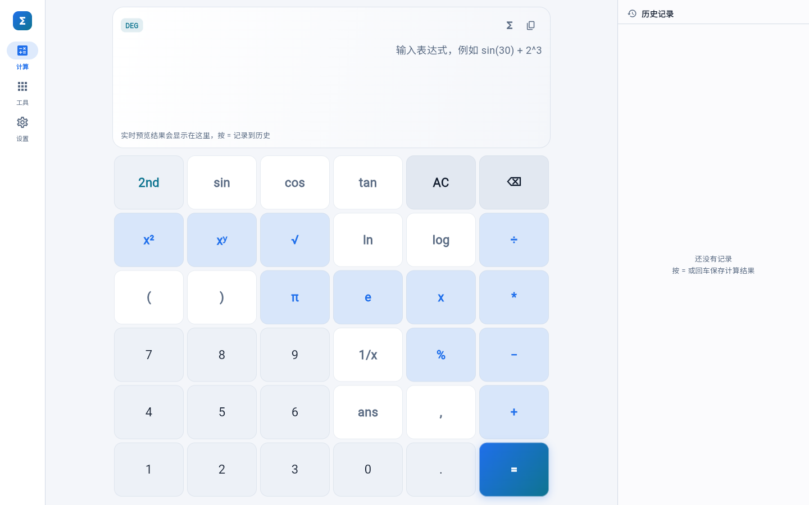
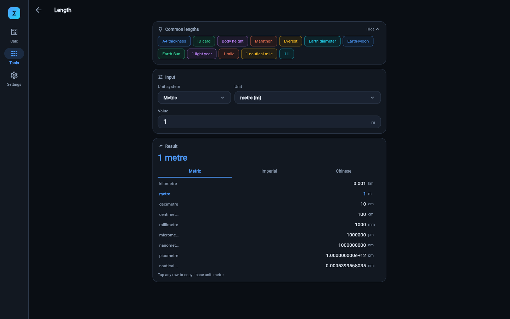
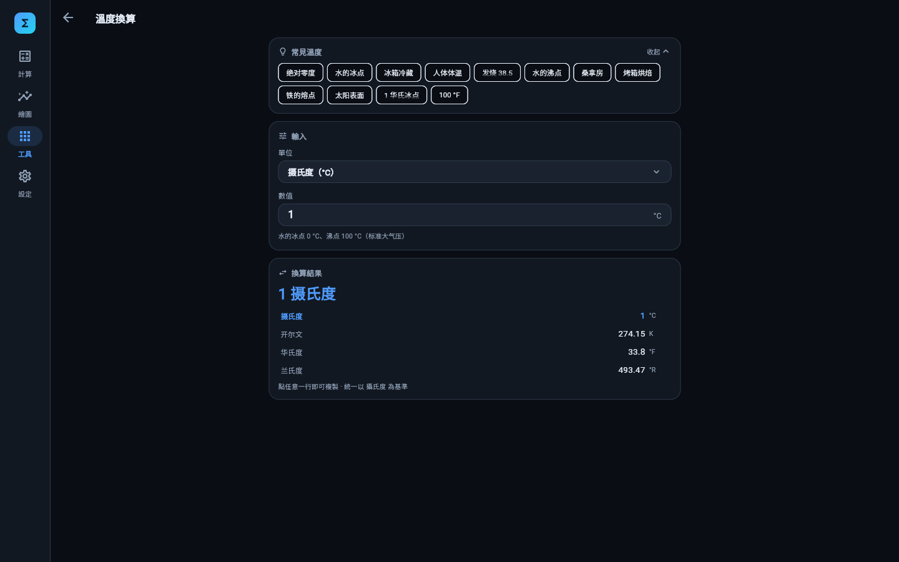

# engineering-assistant


应用名「工程助手」，使用 Flutter 开发的一款面向工程人员的计算工具集：表达式计算、八个单位换算工具、材料用量估算、建筑面积计算与混凝土构件工程量。
支持深色 / 浅色主题与五种界面语言（简体中文、繁體中文、English、日本語、Español）。


## 功能

### 计算

- 自研词法 / 语法分析器 + 递归下降解析，支持完整运算符优先级、右结合幂运算与隐式乘法（`2π`、`3sin(x)`、`(1+2)(3+4)`）
- 实时预览：输入表达式时即时显示结果；按 `=` 或回车写入历史
- 历史记录：点击回填表达式，支持 `ans` 连续计算
- 一键复制为 LaTeX：显示屏的复制菜单可复制 `结果`、`公式（LaTeX）` 或 `公式与结果`；历史记录每条也可复制 LaTeX（如 `\sin\left(30\right) = 0.5`）
- 角度单位一键切换 DEG / RAD（影响全部三角与反三角函数）
- 乘号按键显示为 `*`，粘贴 `×` 也会自动转换成 `*`
- Unicode 输入归一化：`× ÷ − π τ φ √ ∞`、全角括号、上标数字（`x²`）自动转换
- 常量：`π e τ φ ∞`
- 变量：`ans`（上次结果）、`mem`（存储值，支持 M+ / M− / MR / MC）

### 数学能力

| 类别 | 支持内容 |
| --- | --- |
| 三角 | `sin cos tan sec csc cot` 及反函数 `asin acos atan atan2` |
| 双曲 | `sinh cosh tanh asinh acosh atanh` |
| 指数对数 | `exp ln log lg log2`、任意幂 `x^y`、`√`、`cbrt`、`root(n,x)` |
| 取整 | `abs sign floor ceil round trunc frac`、取模 `mod` / `a % b` |
| 组合统计 | `fact`、`gamma`、`ncr`、`npr`、`gcd`、`lcm`、`min`、`max`、`avg`、`hypot` |
| 单位换算 | `deg`、`rad`、`sinc` |
| 随机 | `rand()`、`randint(a,b)` |
| 高级 | 求和 `sum(expr, i, a, b)`、连乘 `prod(...)` |
| 微积分 | 定积分 `integrate(f, x, a, b)`（自适应 Simpson）、数值求导 `diff(f, x, a)`（中心差分 + Richardson 外推） |

数值格式化会自动去除浮点噪声、按需切换科学计数法。

### 单位换算工具

导航栏的「工具」页以应用商店的形式列出八个换算工具，点开即用，全部离线运行：

| 工具 | 覆盖范围 |
| --- | --- |
| 长度换算 | 公制 / 英制 / 市制，米、英尺、英寸、市尺、里等，附常见长度参照物 |
| 面积换算 | 平方米、公顷、英亩、平方英尺、亩、分等 |
| 容量换算 | 毫升、升、英制加仑、石斗升等 |
| 重量换算 | 千克、磅、盎司、市斤、两等 |
| 温度换算 | 摄氏 / 华氏 / 开尔文，仿射换算 |
| 热量换算 | 焦耳、卡路里、瓦时、英热单位等 |
| 压力换算 | 帕、巴、托、psi、标准大气压等 |
| 速度换算 | 米每秒、千米每小时、英里每小时、节等 |
| 材料用量 | 砖块 / 混凝土 / 水泥 / 砂子四个 tab，按体积或建筑面积估材料量 |
| 建筑面积 | 单层 / 多层 / 阳台 / 雨篷 / 门斗 / 车棚货棚六个 tab，按规则算面积并合计 |
| 混凝土构件 | 柱 / 梁 / 板 / 墙 / 楼梯五个 tab，按设计图示尺寸算体积 |



- 每个工具用「1 单位 = 多少基准单位」的分数基准描述换算系数（`unit_catalog.dart`），避免十进制字面量累积误差；温度是仿射换算，单独处理
- 输入一次，结果按体系分 tab 列出全部单位，点结果即复制；带参照物的工具还会给出常见实物对照（如「马拉松 ≈ 42.195 km」）
- 工具在「工具」tab 内部打开（tab 内嵌 `Navigator`），左侧导航栏 / 底部菜单始终保留，返回键或页面左上角箭头回到应用列表
- 每张卡片右上角的图钉可以把工具**置顶**：置顶的工具排在页面最前面（单列一个「置顶工具」分区，其余归到「其他工具」），再点一次图钉即可取消。最多能置顶几个由设置页的「置顶数量」决定，默认 3 个、可在 2 ~ 5 之间调整
- 每个工具都记得上次填的内容：数值、选的单位 / 计量体系都存在本地（键 `tool.<工具 id>`，值是一小段 JSON），重新进入时原样填回；输入停下 400 ms 后写一次盘，离开页面时再兜一次
- 数值框随时可以清空：空着的输入不参与计算（结果显示「—」，换算页回到「填入数值后自动换算」的空状态），
  清空这件事本身也会记住，下次进来仍是空的，不会再填回默认值

Web 端可深链：`?page=tools` 打开工具页（`?page=settings` 打开设置页），`?page=tools&tool=distance`（或 `area`、`volume`、`weight`、`temperature`、`energy`、`pressure`、`speed`、`material`、`building_area`、`concrete`）直接打开某个工具。

### 材料用量（四个 tab）

| tab | 算法 |
| --- | --- |
| 砖块 | 砖数 = 墙体体积 × 512（标准红砖 240×115×53 mm）/ 320（多孔砖）；另列 12 / 24 / 37 墙每平方米 64 / 128 / 192 块，用来快速校核 |
| 混凝土 | 混凝土 = 面积 × 厚度（基础垫层常用 0.1 m，楼板 0.10 ~ 0.15 m） |
| 水泥 | 水泥 = 建筑面积 × 0.03 ~ 0.05 吨/㎡ |
| 砂子 | 砂子 = 建筑面积 × 0.05 m³/㎡ |

例子：24 墙、240 mm 厚、总体积 150 m³ 的砖混住宅，标准红砖 = 150 × 512 = 76,800 块；
1200 ㎡ 垫层、厚 0.1 m，混凝土 = 120 m³；10000 ㎡ 办公楼按 0.05 吨/㎡ 估水泥 500 吨；
1000 ㎡ 住宅按 0.05 m³/㎡ 估砂子 50 m³。

四个 tab 各自记一份输入（键 `tool.material`），输入留空就不算，结果显示「—」；
公式只做方案阶段估算，正式下料以图纸、配合比与当地定额为准。



### 建筑面积（六个 tab）

| tab | 算法 | 要点 |
| --- | --- | --- |
| 单层 | S = L × B | 结构高度 ≥ 2.2 m 算全面积，< 2.2 m 算 1/2 |
| 多层 | S = 层数 × 每层面积 | 按各层外墙结构外围水平面积之和 |
| 阳台 | S = 围护结构外围水平面积 × 1/2 | 无论封闭与否都按 1/2 |
| 雨篷 | S = 结构底板水平投影面积 | 有柱按全面积；无柱宽度 > 2.1 m 才算 |
| 门斗 | S = 围护结构外围水平面积 | 结构层高 ≥ 2.2 m 算全面积，不足算 1/2 |
| 车棚 / 货棚 | S = 顶盖水平投影面积 × 1/2 | 有顶盖、无围护结构 |

每个 tab 底部有「合计建筑面积」，把六部分里已填的数字加起来（没填的按 0 处理，六项都没填就显示「—」），
输入同样各自记在本地（键 `tool.building_area`）。正式报建仍以现行规范与图纸为准。



### 混凝土构件（五个 tab）

通用规则：按设计图示尺寸以体积计算，**不扣除**钢筋、螺栓、预埋铁件，以及单个
≤ 300 mm × 300 mm 的孔洞。

| 构件 | 公式 | 关键说明 |
| --- | --- | --- |
| 矩形柱 | V = a × b × H | a、b 为截面尺寸；H 取基础顶面至梁底（无梁时算至板底） |
| 矩形梁 | V = a × b × L | a、b 为截面尺寸；L 取柱间净距，与柱相交部分不重复计算 |
| 现浇板 | V =（净长 × 净宽 − 扣除孔洞）× 板厚 | 净长、净宽算至梁侧；单个孔洞 > 0.3 ㎡ 才扣，≤ 300 × 300 mm 一律不扣 |
| 混凝土墙 | V = 墙长 × 墙高 × 墙厚 | 与板连接算至板底，与梁连接算至梁底 |
| 楼梯 | V = 水平投影面积 × 折算厚度 | 折算厚度按定额取 0.2 ~ 0.3 m，常用 0.25 m；面积含踏步与休息平台 |

例子：500 × 500 mm、高 3 m 的柱 = 0.75 m³；250 × 500 mm、净长 6 m 的梁 = 0.75 m³；
6 m × 4 m、板厚 0.12 m 的板 = 2.88 m³（扣掉 0.5 ㎡ 孔洞后 2.82 m³）；
墙长 5 m、高 3 m、厚 0.2 m 的墙 = 3 m³；12 ㎡ 楼梯按 0.25 m 折算 = 3 m³。

五个 tab 各自记一份输入（键 `tool.concrete`），单项结果直接显示体积。每个输入框都带一个常用
默认值（柱 500 × 500 mm / 3 m、梁 250 × 500 mm / 净长 6 m、板 6 × 4 m / 板厚 120 mm、
墙 5 × 3 m / 厚 200 mm、楼梯 12 ㎡ / 折算 0.25 m），打开就能看到结果；数值随时可以清空，
清空这一格的体积就显示「—」，清空状态本身也会记住。

打开时默认停在哪个 tab 可以在设置页里改（「工程计算默认值」→「默认标签页」，键 `concrete.tab`，
默认柱）；上次手动切换过的 tab 优先，改设置会清掉记住的 tab 让新默认值立刻生效。



## 设置与多语言

导航栏第四项「设置」里可以切换外观与界面语言，选择立刻生效并记在本机
（Web 用 `localStorage`，Windows / Android 写入用户配置目录的 `engineering-assistant/settings.json`）。



- **外观**：跟随系统 / 浅色 / 深色。深色与浅色各有一套完整配色
  （`lib/theme/app_theme.dart` 的 `kDarkPalette` / `kLightPalette`），
  不只是换背景色，卡片、描边、按键渐变都跟着换
- **语言**：下拉框切换简体中文、繁體中文、English、日本語、Español；首次启动跟随系统语言
  （系统语言不在支持列表里时用英文），之后以设置里选的为准。工具卡片名称、卖点
  与工具内文案都随语言切换
- **置顶数量**：工具页最多能置顶几个工具（2 ~ 5，默认 3），卡片右上角显示当前「已置顶 2 / 3」；
  置顶项本身在工具页点图钉切换，存在本地（键 `pinned_tools` / `pinned_limit`）
- **单位换算默认值**：长度 / 面积 / 容量 / 重量 / 速度五个换算工具各记一套「默认计量体系」与
  「结果默认 tab」（速度没有市制，选项只有公制 / 英制）；温度 / 热量 / 压力不分体系，
  卡片里只有「默认单位」一项；八个换算工具的值各存一份，改动长度换算不影响面积换算
- **工程计算默认值**：混凝土构件打开时默认停在哪一类构件（柱 / 梁 / 板 / 墙 / 楼梯，键 `concrete.tab`）
- **材料用量 / 建筑面积**：没有设置项，各 tab 的输入各自记在本地
- **关于**：版本号与仓库地址，一键复制链接

浅色模式下的计算器（按键、显示屏、工具卡片都已跟着变浅）：



Web 端可深链：`?page=settings` 直接打开设置页，`?page=tools` 同理；
`?theme=light` / `?theme=dark` 用指定配色启动，`?lang=zh-Hant`（或 `zh-Hans` / `en` / `ja` / `es`）
用指定语言启动——两者都只对当前这次打开生效，不会改掉本机存的偏好（截图与分享链接用）。

同一批页面在英文与繁体中文下的样子：




### 多语言的组织方式

- **应用级文案**在 `lib/l10n/`：`AppStrings` 是抽象类，五种语言各一个实现，
  用 `t.xxx` 取当前语言文案（`t` 依赖全局当前语言，切换后整棵树重建）
- **工具语言包**和逻辑、界面放在同一个目录，如 `lib/ui/tools/distance/distance_lang.dart`：
  `const Map<AppLanguage, ToolText> kDistanceLang`，每个语言两项——名称、卖点。
  `ToolInfo` 只存这份 map，`tool.name` 等 getter 按当前语言取，缺翻译回落简体中文
- **工具页内部文案**再各放一份 `<tool>_strings.dart`：一个 `class <Tool>Strings`
  用 `required` 具名字段列出全部文案，配合 `const Map<AppLanguage, <Tool>Strings>`
  与 `<Tool>Strings get <tool>Strings`（`required` 保证五种语言不缺项、漏写直接编译报错）。
  带参数的话术一律写成 `{0}` / `{1}` 模板，用 `fill()` 填充，避免在代码里拼句子
- 八个换算工具共用 `lib/ui/tools/widgets/unit_convert_strings.dart`，材料用量另有
  `lib/ui/tools/material/material_strings.dart`，
  体系名称统一走 `measureSystemLabel()`
- **换算数据层也带语言**：`MeasureUnit.names` / `MeasureSample.names` 存 en / ja / es，
  `labelIn(language)` 取不到就回落简体中文（`zhHant` 与 `zhHans` 都用原文）；
  单位说明 `MeasureUnit.notes` 存 en / ja / es，`noteIn()` 对中文回落原文、缺翻译时回落英文
- **计算器页**同样走 `lib/l10n/`：`calc_strings.dart`（`kCalcStrings`）覆盖键盘提示、
  历史面板、函数库的分类与 48 条函数说明。函数说明按内置函数名查表，
  简体直接复用 `lib/core/builtins.dart` 的中文，其余四种语言必须翻全（测试会逐条检查）
- **运算错误也走多语言**：`CalcException` 带 `CalcError` 枚举 + 模板参数 + 出错位置，
  数据层的简体中文模板在 `lib/core/calc_error.dart`，其余四种语言在
  `lib/l10n/calc_errors.dart`（`calcErrorMessage()` 按当前语言填充并追加位置）。
  预览区与历史记录的报错都现算当前语言，切换语言后已显示的报错跟着换

## 应用图标

根目录下 1536×1536 的 `logo.jpg` 是唯一的图标源图，Web / Windows / Android 共用：

改图后执行一次即可同步所有平台：

```bash
just icons         # 由 logo.jpg 生成全部图标
just icons-check   # 只校验文件是否齐全（CI 可用）
```

脚本只依赖 Pillow。Windows 上默认的 `python` 常常没装它，所以这两个配方都经
`tool/with_pillow.sh` 执行：依次试 `$PYTHON_ICONS`、`python3`、`py -3`、`python`，
都没有 Pillow 时自动退回 WSL 的 `python3`，全都不行才提示 `pip install pillow`。

生成的内容：

| 平台 | 文件 |
| --- | --- |
| Web | `web/favicon.png`、`web/icons/Icon-192/512.png`、`web/icons/Icon-maskable-192/512.png` |
| Windows | `windows/runner/resources/app_icon.ico`（16–256 七种尺寸，任务栏 / 资源管理器） |
| Android | `mipmap-*/ic_launcher.png`、`ic_launcher_round.png`，以及自适应图标 `ic_launcher_foreground.png` + `mipmap-anydpi-v26/ic_launcher.xml` |

处理规则：

- **不透明底（当前 `logo.jpg` 就是）**：原图就是一张完整画面，**不裁剪、不补白**，整张按原比例缩放。
  普通图标（favicon、Web 图标、Windows ico、Android 旧版 `ic_launcher`）就是这张原图的等比缩略。
- **会被系统蒙版裁切的图层**不能铺满：Web 的 maskable 图标系统只保证中间 80% 可见
  （`MASKABLE_SAFE_ZONE = 0.80`），整张图缩进去、外圈用源图底色补；
  Android 8+ 的自适应图标在 108dp 画布里只有中间 72dp 一定可见，所以不透明源的
  前景直接铺满——边缘被蒙版裁掉也无所谓。
- 自适应图标的 `ic_launcher_background` 取源图四周一圈像素的平均色，
  蒙版把前景裁成圆形 / 方形时露出的就是这个色，和源图底色无缝。

**透明底 PNG** 也能直接替换：保留透明背景，按不透明像素裁掉四周留白（`trim_transparent`），
再按统一比例补回（`LOGO_FILL = 0.92`）；maskable / 自适应这类蒙版图层会垫一层深色底
（`#0B0F14`，与深色主题一致）并把图形缩进 `SAFE_ZONE = 0.72`，避免被裁边。

透明底 logo 自带多少留白都不影响图标大小。`just check` 里的 `tool-check` 会跑 `tool/generate_icons.py --selftest`，用内存里的合成图验证裁边、补白、安全区与平台尺寸表。
项目暂无 iOS / macOS 目录，如需新增平台，脚本里加一段尺寸表即可。

## 运行

```bash
flutter pub get
flutter run -d chrome       # Web
flutter run -d windows      # Windows 桌面
flutter run                 # Android 设备 / 模拟器
```

Web 端可用 `?page=tools` 直接打开工具页，`?page=tools&tool=distance` 再打开某个换算工具。

## Web 部署

`just build-web` 产出的 `build/web` **完全自包含**，可直接拷到内网服务器或离线环境运行：

- **CanvasKit 与 Flutter 运行时**用 SDK 自带副本（`flutter build web --no-web-resources-cdn`），不再从 `www.gstatic.com` 动态 import
- **字体**放在 `build/web/fonts/`：`web/flutter_bootstrap.js` 把引擎的 `fontFallbackBaseUrl` 指向 `fonts/`，
  CanvasKit 渲染文字时会从本地取 Roboto（拉丁）与 Noto Sans SC 等分片，不再请求 `fonts.gstatic.com`

字体文件由 `tool/web_fonts.py` 从本地 Flutter SDK 的 `font_fallback_data.dart` 读出清单后下载（共 111 个分片、约 3 MB），
已加入 `.gitignore`，首次构建前会自动执行（也可手动 `just web-fonts`）。

若部署环境能直连 Google，可用 `just build-web-cdn` 得到更小的产物；此时若用户断网，会出现
`Failed to load font Roboto at https://fonts.gstatic.com/...` 与
`Failed to fetch dynamically imported module: https://www.gstatic.com/flutter-canvaskit/...`。

## 开发命令（just）

项目用 [just](https://github.com/casey/just) 管理常用任务，`just` 不带参数即可列出全部命令。

- **WSL**：自动通过 `cmd.exe` 调用 Windows 侧的 Flutter，无需额外配置
- **Windows（PowerShell / cmd）**：recipes 由 POSIX `sh`（Git Bash 或 Cygwin 的）执行，需安装
  [Git for Windows](https://git-scm.com/download/win)；`flutter` / `dart` 一律经 `cmd.exe` 调用
  `flutter.bat` / `dart.bat`（它们本身是 bash 脚本，PATH 里的 `bash` 若指向 WSL 会直接报
  `No such file or directory`）。`just icons` / `just check` 里的图标脚本还需要
  `pip install pillow`

```bash
just              # 列出全部命令
just deps         # flutter pub get
just run          # 运行（可附加参数：just run -d chrome）
just web          # Chrome 中调试 Web（本地 CanvasKit，断网可用）
just windows      # Windows 桌面调试
just android      # Android 调试
just devices      # 列出设备
```

| 分组 | 命令 | 说明 |
| --- | --- | --- |
| 质量 | `just analyze` | 静态分析 |
| 质量 | `just fmt` / `just fmt-check` | 格式化 / 检查格式 |
| 质量 | `just test` | 全部测试（`just test 换算` 按名称过滤） |
| 质量 | `just test-core` / `test-widget` | 分模块测试 |
| 质量 | `just cover` | 生成覆盖率 `coverage/lcov.info` |
| 质量 | `just check` | 格式检查 + 分析 + 测试 |
| 构建 | `just build-web` / `build-apk` / `build-windows` | 分平台构建 |
| 构建 | `just build-web-cdn` | Web 构建（CanvasKit / 字体走 Google CDN，体积小） |
| 构建 | `just web-fonts` | 下载 Web 离线字体到 `web/fonts/`（约 3 MB） |
| 构建 | `just build` | Web + APK |
| 构建 | `just ci` | 依赖 → 检查 → 构建 |
| 工具 | `just preview` | 构建并本地预览（<http://localhost:8765>） |
| 工具 | `just shots` | 重新生成 `docs/screenshots` 截图 |
| 工具 | `just icons` / `just icons-check` | 由 `logo.jpg` 生成 / 校验各平台图标（`--selftest` 已在 `tool-check` 里跑） |
| 工具 | `just clean` / `just outdated` | 清理产物 / 查看可升级依赖 |

## Android 构建

Android 构建需要本机具备 Android SDK 与 JDK 17+（Web / Windows 构建不需要）。若未安装，`just build-apk` 会直接给出中文提示并退出：

```
✗ 没有检测到 Android SDK，构建无法继续。
```

### 方案一：Android Studio（图形界面，最省事）

1. 安装 [Android Studio](https://developer.android.com/studio)，首次启动时用 SDK Manager 装好 SDK
2. SDK Platforms 勾选 **Android 16 (API 36)**；SDK Tools 勾选 **Build-Tools 36.0.0**、**Platform-Tools**
3. 设置环境变量（Android Studio 自带的 JBR 可直接当 JDK 用）：

   | 变量 | 示例值 |
   | --- | --- |
   | `ANDROID_HOME` | `%LOCALAPPDATA%\Android\Sdk` |
   | `JAVA_HOME` | `C:\Program Files\Android\Android Studio\jbr` |

### 方案二：只装 commandline-tools（体积小，纯命令行）

```powershell
# 1) JDK 17+：从 https://adoptium.net 下载 zip 解压即可（无需安装）
# 2) commandline-tools 解压到 %LOCALAPPDATA%\Android\Sdk\cmdline-tools\latest
#    https://developer.android.com/studio#command-line-tools-only

# 3) 写入用户环境变量，重开终端生效
setx ANDROID_HOME "$env:LOCALAPPDATA\Android\Sdk"
setx JAVA_HOME "C:\Users\<你>\jdks\jdk-21"

# 4) 接受许可并安装 SDK 包（compileSdk 36 需要 android-36）
sdkmanager --licenses
sdkmanager "platform-tools" "platforms;android-36" "build-tools;36.0.0"
```

### 校验与构建

```powershell
flutter doctor -v      # Android toolchain 应为 ✓（会列出 SDK 路径与 Java 版本）
just build-apk         # 产物：build/app/outputs/flutter-apk/app-release.apk
```

### 在真机 / 模拟器上调试

```powershell
just emulator          # 启动第一个 AVD（模拟器窗口出现后等它开机完成）
just android           # 自动选中第一个 Android 目标并 flutter run（Ctrl-C 退出）
just devices           # 列出当前可用设备
```

首次用模拟器要先装模拟器与系统镜像、并创建一个 AVD：

```powershell
sdkmanager "emulator" "system-images;android-36;google_apis;x86_64"
avdmanager create avd -n engineering_assistant_api36 -k "system-images;android-36;google_apis;x86_64" -d pixel_7
```

> `just android` 依赖 `tool/android_target.py` 从 `flutter devices --machine` 里挑设备。旧写法是写死的 `-d android`：Flutter 的 `-d` 只按设备 id / 名称前缀匹配（模拟器叫 `emulator-5554`），所以永远报 `No supported devices found with name or id matching 'android'`。
>
> 模拟器一直停在 `offline`：多为上次非正常退出留下锁文件，删掉 `%USERPROFILE%\.android\avd\<名字>.avd\*.lock` 后重新启动即可；也可试试 `adb kill-server` → `adb start-server`。

> `just build-apk` 会先执行 `tool/android-env.sh`：`JAVA_HOME` / `ANDROID_HOME` 没设或失效时，自动在 `%USERPROFILE%\jdks\*`、Android Studio 自带的 jbr、`%LOCALAPPDATA%\Android\Sdk` 里探测。所以刚写完环境变量、没重开终端也能构建；探测不到才会报错。WSL 里调用时会通过 `WSLENV` 把这两个变量传给 Windows 侧的 Flutter / Gradle。
>
> **Gradle 发行包下载卡住**：首次构建要从 `services.gradle.org` 拉 Gradle（约 220 MB），国内网络常超时。可把 `android/gradle/wrapper/gradle-wrapper.properties` 里的 `distributionUrl` 临时换成镜像（如 `https://mirrors.cloud.tencent.com/gradle/gradle-9.1.0-all.zip`），或提前把 zip 放进 `%USERPROFILE%\.gradle\wrapper\dists\gradle-9.1.0-all\<hash>\` 并解压。
>
> 也可以不改环境变量，直接告诉 Flutter SDK 位置：`flutter config --android-sdk "C:\Users\<你>\AppData\Local\Android\Sdk"`。
>
> WSL 中执行 `just build-apk` 同样是调用 Windows 侧 Flutter，因此 SDK 需装在 Windows 上。

## 测试

```bash
just test
```

包含计算引擎单元测试（优先级、隐式乘法、函数、微积分、错误处理、格式化）、LaTeX 序列化（运算优先级、函数、求和 / 积分 / 求导、异常输入）单元测试、
长度 / 面积 / 容量 / 重量 / 温度 / 热量 / 压力 / 速度单位换算（含仿射温度与任意两单位互逆、分数基准的精确性、参照物、单位名与说明的多语言回落）单元测试，
以及多尺寸布局、复制 LaTeX、工具页跳转、工具页内导航菜单保留、
长度换算下拉框 / 体系 tab / 可折叠参照物、温度不分体系的一次性结果列表（仿射换算）与默认单位、热量瓦时 / 焦耳 / 卡路里互转、
压力巴 / 托 / psi 互转、速度千米每小时换算、换算工具默认体系与结果 tab 各工具独立、
设置页主题切换（含配色与本地写入）、浅色模式下按键 / 显示屏 / 工具卡片配色、语言下拉框切换后导航与工具卡片文案、
五种语言文案表完整性、工具置顶（默认 3 个上限、顶满后不再添加、取消置顶不受限、上限夹在 2 ~ 5、读坏的置顶项不影响加载）、
手机尺寸卡片与工具页不溢出、工具页输入草稿（数值与所选单位写盘后能读回、清空的输入会记住而 null 才删字段、损坏内容不影响加载）、
`?lang=` 深链指定语言且不写回本地、换算页打开着切语言时标题与单位名跟着换、
计算器与工具页在英文界面下的提示 / 历史 / 函数库分类与说明全是英文、
运算错误提示按语言本地化（含位置与占位符参数）等 Widget 与单元测试。


## 目录结构

```
lib/
├── core/       词法、语法、AST、求值器、内置函数、数字格式化、计算引擎、LaTeX 导出
├── l10n/       多语言：语言枚举、应用级文案（AppStrings 五个实现）、计算器文案、
│                取文案的全局入口
├── models/     历史记录数据模型
├── services/   本地设置存储，条件导入隔离 Web / 桌面差异
├── state/      计算器 / 设置控制器（ChangeNotifier）
├── ui/         页面与组件（键盘、显示屏、历史面板、设置页）
│   └── tools/  工具页与各工具（每个工具一个目录：逻辑、界面 <tool>_page.dart、defined.dart、
│                setting.dart、<tool>_lang.dart 语言包；共用输入框 / 比例条 / 换算页在 widgets/，
│                单位换算共用的 unit_catalog.dart 在本层）
└── theme/      深色 / 浅色两套配色与 ThemeData
test/           引擎、LaTeX、工具算法、Widget 测试
tool/           辅助脚本（截图、图标生成、Android 环境探测）
justfile        常用开发任务
```

## 常见问题

- **Windows 首次构建报 `Unsupported file type "notFound" ... flutter_windows.dll.pdb`**：Flutter SDK 的引擎产物下载不完整，执行 `just precache`（即 `flutter precache --windows --force`）重新下载即可。
- **PowerShell 下 `just` 报 `$'\r': command not found`**：recipes 需要 Git Bash，确认 `sh.exe` 在 PATH 中（安装 Git for Windows）。
- **Web 版白屏，控制台报 `Failed to fetch dynamically imported module: https://www.gstatic.com/flutter-canvaskit/...`**：产物用了 CDN 版 CanvasKit，网络被墙或离线时加载失败。用 `just build-web` 重新构建（本地 CanvasKit），不要用 `build-web-cdn`。
- **Web 版文字变成方块 / 报 `Failed to load font Roboto ... fonts.gstatic.com`**：`web/fonts/` 缺失或没拷进产物，执行 `just web-fonts` 后重新 `just build-web`。
- **`just build-web` 报 `✗ 找不到 Flutter SDK`**：`tool/web_fonts.py` 需要定位 SDK，设置 `export FLUTTER_ROOT=D:/flutter` 即可。
- **`just android` 报 `No supported devices found with name or id matching 'android'`**：没有任何 Android 设备在线。真机需打开「开发者选项 → USB 调试」并允许本机调试；用模拟器则先 `just emulator`（首次需按上文创建 AVD）。
- **`just build-apk` 报 `No Android SDK found`**：参见上文「Android 构建」，装好 SDK / JDK 并设置 `ANDROID_HOME`、`JAVA_HOME` 后重开终端。
- **`just build-apk` 报 `Please set the JAVA_HOME variable`**：旧终端读不到新写入的用户变量。`tool/android-env.sh` 会自动探测常见 JDK 路径，探测不到时新开终端即可；也可在当前会话临时设置 `$env:JAVA_HOME='C:\Users\<你>\jdks\jdk-21'`。

## 说明

- 计算引擎不依赖第三方数学库，`sum` / `integrate` / `diff` 等以特殊形式在求值阶段处理，因此可对变量求值。
- 计算器页的 `MathEngine` 实例在应用内共享，角度模式、解析缓存保持一致。
- 单位换算的数据层（`lib/ui/tools/unit_catalog.dart`）不依赖 Flutter，新增单位只需追加数据并补齐多语言名称与说明。

## 协作约定

提交前跑 `just check`（格式化 + 静态分析 + 全部测试）；**每次开发完成后立即提交并推送到远程**（`git push origin main`）。完整约定见 [AGENTS.md](AGENTS.md)。
